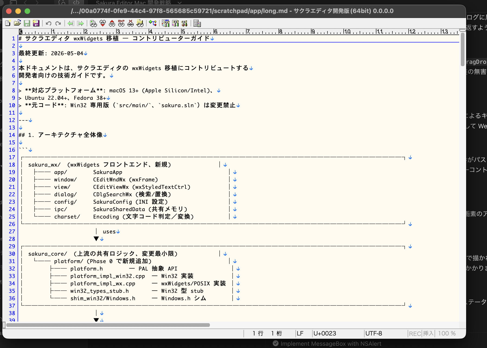
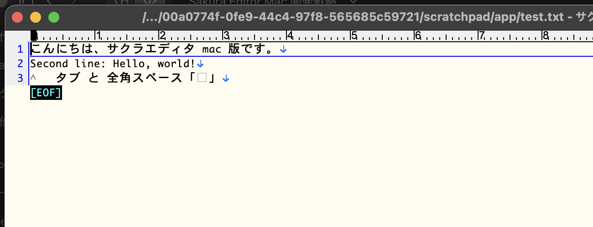

# 移植作業進捗ログ

## 2026-11-07 — 残りのメニュー確認で見つかったクラッシュ 2 件

- [x] **UTF-7 で開き直すと落ちる**: 並列読み込みのワーカーを準備する `CFileLoad::Prepare` が `m_nReadOffset2` を初期化しない。
  上流の不具合で、未初期化の値を使うのは UTF-7 だけ。Prepare で 0 にした。`a+-b` `+MEIwRDBG-` が `a+b` `あいう` になることを確認
- [x] **タブバーを表示すると落ちる**: `LayoutTab` → SetWindowPos → WM_SIZE → `OnSize` → `LayoutTab` の無限再帰。
  winport の SetWindowPos が大きさの変わらないときも WM_SIZE を送っていた。Win32 と同じく変わらない分は SWP_NOSIZE / SWP_NOMOVE を立てる
  - クラッシュレポートは再帰を折りたたむ（`recursionInfoArray`）。フレーム数だけ見てスタック不足と誤認し、8MB に増やしても
    落ちたので取り消した。レポートは終了の数秒後に作られるので、判定には終了コードを使う
- [x] メニュー総当たりの結果: ファイル・設定・ウィンドウ・ヘルプ 64 項目、編集・変換・検索・ツール 139 項目を修正後に実行し、クラッシュなし
  - 対象外: 保存・閉じる・終了・新規・最近使ったファイル、コピー系、Grep、外部コマンド、マクロ実行、「して保存」
  - クリックが届かなかった項目: 表示名が切り替わる 3 件、名前に `/` を含む 2 件、キーマクロの実行（原因未確認）
  - 「印刷」はプリンターなしの案内を出してプレビューに入る。プレビューは白紙で、「戻る」で復帰できる
  - タブバーは表示しても落ちないが、SysTabControl32 が未実装なのでタブは出ない（Week 8）

## 2026-11-05 — 日付挿入のクラッシュ修正

- [x] **日付挿入で segfault**（ユーザーが実機で発見）: GetDateFormatW がスタブで何も書かず、上流は戻り値を見ないので
  未初期化の `szText` がそのまま本文に入り、0xFFFF を超える値で `m_nCharPxWidthCache[c]` が範囲外アクセスになった
  - GetDateFormatW / GetTimeFormatW を実装（`kernel32.cpp`）。ロケールは日本語と en-US。失敗時も空文字列を入れる
  - 既定の書式は ja-JP の `yyyy'年'M'月'd'日'` と `H:mm:ss`。実機で `2026年11月5日` `7:46:10` を確認
- [x] **レジストリのスタブが成功を返していた**: 0 は ERROR_SUCCESS なので、ReadRegistry が未設定のバッファを読む。
  Reg* をすべて「キーなし」で実装（mac にレジストリは無い）
- [x] スタブの呼び出し元を確認。同じ形で通常操作から届くのは上の 2 件のみ。残りは I-118
- [x] メニュー総当たり: 編集・変換・検索・ツールの 139 項目を実行し、クラッシュなし（`…` の項目も開閉を確認。
  コピー系・Grep・外部コマンド・マクロ実行・「して保存」は対象外）

## 2026-11-04 — Week 6: ダイアログ・開く/保存/フォント・クリップボード・ドロップ

- [x] **方針変更**（ユーザー確認済み）: ダイアログは作り直さず互換層で動かす。上流の 61 ダイアログがほぼ 6 種類の
  コントロールでできていると分かったため。CLAUDE.md と mac_native_plan.md を更新
- [x] **ダイアログ機構**（`winport/src/dialog.cpp`）: DialogBox / CreateDialog / DefDlgProc / IsDialogMessage
  - rc2winport.py が RT_DIALOG を Windows と同じ形式で出力する（62 個）。CDlgFuncList はテンプレートを書き換えるので形式を合わせた
  - rc.exe はスタイル指定があると COMBOBOX の既定 CBS_SIMPLE を使わない。OR すると CBS_DROPDOWNLIST になり入力欄が消える
  - ダイアログ単位は 7x13。Hiragino は ＭＳ Ｐゴシックより幅が広いので 6 だと文字が切れた
  - Tab / 矢印 / Enter / Esc / Option+ニーモニック、モーダル中の所有者の無効化、ダイアログを所有者の前に保つ処理
- [x] **コントロール**（`winport/src/dialog_controls.cpp`）: BUTTON / STATIC / EDIT / LISTBOX / COMBOBOX / UpDown
  - 上流がサブクラス化するので Win32 のウィンドウプロシージャとして実装。ドロップダウンの一覧だけ NSMenu
- [x] **開く／保存**（`winport/src/commdlg.cpp`）: NSOpenPanel / NSSavePanel
  - 上流のフックのテンプレートを非表示で動かし、コンボとチェックを補助ビューへ写す。OK で値を書き戻して CDN_FILEOK を送る
  - sakura_core の変更: IFileDialog 版を使わない、上書き確認はパネルに任せる、複数選択の区切りを `/` に（いずれも `SAKURA_WINPORT`）
- [x] **フォント**: NSFontPanel は補助ビューが表示されず changeFont: も届かなかったので、NSAlert にファミリー・サイズ・太字・斜体を載せた
- [x] **クリップボード**: CloseClipboard で NSPasteboard へ書き、他のアプリのコピーは changeCount で検知して取り込む
  - 自分のコピーは ClipData のままなので、サクラの独自形式が残る。開いたまま IsClipboardFormatAvailable を呼ぶと止まる不具合も修正
- [x] **ドロップ**: NSDraggingDestination → WM_DROPFILES（本物の DROPFILES 形式）。DragAcceptFiles したウィンドウを優先
- [x] **GetPrivateProfileIntW**: sakura.exe.ini のマルチユーザー設定の読み取り
- [x] 確認（実機）
  - 検索（ヒット箇所のハイライト）、見つからないときのメッセージ、すべて置換（2 箇所、保存内容も一致）
  - ジャンプ（3 行 1 桁へ移動）、Grep（実ファイルを走査して結果ウインドウが開く）
  - 開く（別ウインドウで開く）、名前を付けて保存（SJIS + CRLF を指定して `82a0...0d0a` を確認）
  - フォント変更の反映、実際のドラッグでのドロップ、クリップボード（絵文字を含む往復）
  - バージョン情報、ファイルのプロパティも追加作業なしで表示できた。検索を開いたままの Cmd+Q も終了する
  - ctest 緑
- 申し送り
  - 未確認: ダイアログの入力欄での日本語入力、Grep ダイアログのフォルダー欄へのドロップ、複数ファイルの選択
  - 未実装のコントロールと設定画面は I-114。Finder からファイルを開く処理は Week 8

## 2026-11-04 — Week 5: IME・メニューバー・コンテキストメニュー・Cmd+Q

- [x] **IME**（`winport/src/imm32.cpp`、`cocoa_backend.mm` の WPView）: NSTextInputClient を実装
  - 未確定文字列は表示系がキャレット位置に重ねて描く。確定文字列は WM_IME_COMPOSITION(GCS_RESULTSTR) で
    渡すので、Windows と同じく 1 確定 = 1 Undo になる
  - 候補ウィンドウの位置は表示系が持っているキャレット情報から返す（メインスレッドは Win32 を待たない）
  - 確認: `kanji` → スペース → Return で `感じ` が入り、保存ファイルも一致
- [x] **メニューバー**: HMENU を読んで NSMenu を組み立てる
  - 開く直前に所有スレッドで WM_INITMENUPOPUP を処理させ、その結果で作り直す。項目の内容・有効/無効・
    チェックはサクラ本体の判定のまま。表示系が Win32 を待つ唯一の箇所で、500ms で打ち切る
  - 表記の `(&O)` と `&` は取り除き、`Ctrl+Shift+S` は ⇧⌘S と表示する。キー入力は WPWindow.sendEvent が
    先に受けるので、メニューのショートカットは表示専用（二重実行しない）
  - ウィンドウがキーになるたびにそのウィンドウのメニューへ差し替える
- [x] **コンテキストメニュー**: TrackPopupMenu を NSMenu で実装。閉じるまで Win32 スレッドは WM_PAINT を処理する
- [x] **Cmd+Q**: 全トップレベルウィンドウへ閉じる要求を出す。保存確認で「キャンセル」なら終了しない
  - Cmd+Q だけはアプリの終了に使い、サクラの Ctrl+Q には渡さない（I-112）
- [x] **複数ウィンドウが開かなかった問題**: 「新規作成」で 2 枚目のエディタが即終了していた
  - ウィンドウクラスを全仮想プロセスで共有していたため 2 回目の RegisterClassEx が失敗していた。
    所有プロセスを持たせ、同じプロセスからの二重登録だけを失敗させる
- [x] 確認（実機、CGEvent と Accessibility で操作）
  - メニューの中身、ショートカット表示、Undo の有効/無効が編集に連動し、アクティブなウィンドウに追従する
  - メニューから「すべて選択」「新規作成」、コンテキストメニューから「すべて選択」、メニュー外クリックで取り消し
  - Cmd+Q: 変更ありで はい（保存して終了）/ いいえ / キャンセル、変更なしは即終了、2 枚同時も終了
  - ctest 緑
- 申し送り
  - 「新規ウインドウを開く」が灰色なのは上流の仕様（タブモード時のみ有効）。タブは Week 8
  - 貼り付けが無効なのはクリップボード未実装のため（Week 6）
  - ダイアログを開く項目は未実装の DialogBox に当たる（Week 6）

## 2026-11-04 — Week 4: スクロールバー・ツールバー・ステータスバー・本物の ROP



- [x] **メッセージボックス**: NSAlert で実装。変更ありのウィンドウを閉じるときの「はい／いいえ／キャンセル」が動く
  - 上流の `Wrap_MessageBox` は標準エラーがあるとダイアログを出さず 0 を返す（テスト用）。
    `GetStdHandle` はアプリ動作時に null を返すようにした（Windows の GUI アプリと同じ）
  - 閉じるまで Win32 スレッドは送信メッセージと WM_PAINT を処理し続ける。アラートは main queue ではなく
    ランループへ積む（main queue のブロック内で runModal すると他の表示処理が止まるため）
- [x] **組み込みコントロール**（`winport/src/controls.cpp`）: Win32 のウィンドウプロシージャとして実装し GDI で描く
  - `SCROLLBAR`（SB_CTL、つまみのドラッグ・ページ送り）、ステータスバー（SB_*、オーナードロー含む）、
    ツールバー（TB_*、クリック・ドロップダウン通知・状態更新）、プログレスバー
- [x] **本物の ROP**: R2_XORPEN / R2_NOTXORPEN / R2_NOT / PATINVERT / DSTINVERT を画素の直接演算にした。
  選択範囲の反転とルーラーのキャレット表示はこれに依存している（I-108 解決）
- [x] **ビットマップ**: DIB リソースの読み込み（LoadImage / LoadBitmap）、イメージリスト、AlphaBlend。
  ツールバーに上流のアイコンが表示される
- [x] ole32 / shell32 の「機能が無いだけ」の関数は成功を返す（`shell_ole.cpp`）。
  上流は RegisterDragDrop の失敗でメッセージボックスを出すため
- [x] 修飾キーの状態をキーイベントごとに同期。Alt+F4 はトップレベルへ
- [x] GDI 依存で除外していた上流テストを復帰。717 件中 716 件が通り、残り 1 件は MS ゴシックの画素幅の決め打ち

動作確認: 長いファイルの表示、Shift+↓ の選択、スクロールバーのクリック、変更ありの閉じる（Esc でキャンセル／いいえ）。

### 自動テストの注意

`osascript` や HID へのイベントは前面のアプリへ行くので、作業中のユーザーの操作に割り込む。
キー入力は `CGEventPostToPid` で対象プロセスにだけ送る。閉じるボタンは AX の click で押す。

### 未対応（Week 5 以降）

- メニューバー、ポップアップメニュー、IME（Week 5）。ダイアログ、NSPasteboard、D&D（Week 6）
- ツールバーの検索ボックス（COMBOBOX は未実装）、ツールチップ
- タブバー、ファンクションキーの表示は未確認
- スクロールバーのドラッグは未検証（クリックのみ確認）

## 2026-11-04 — Week 3: 上流の CEditView が mac のウィンドウで動作（判断 2 通過）



上流の sakura（コントロールプロセス + エディタプロセス）が mac 上で起動し、CEditWnd / CEditView が
日本語ファイルを表示する。行番号・ルーラー・タブ記号・全角空白記号・改行記号・カーソル行下線・[EOF] は
上流の描画コードそのもの。キー入力（Cmd → Ctrl）、マウスクリックでの移動、Cmd+S での保存を確認した。

- [x] **設計: 仮想プロセス**（詳細は mac_native_plan.md）
  - 1 スレッド = 1 sakura プロセス。自分自身の `CreateProcess` はスレッド起動に置き換え
  - `design_template.h`: プロセス単位のシングルトンを thread_local に（上流コードへの変更はこの 1 ファイル）
  - 名前付きミューテックス／イベント／ファイルマッピングはプロセス内で共有
- [x] **user32**（`user32_window.cpp` / `user32_message.cpp` / `user32_misc.cpp`）
  - ウィンドウクラス、生成（WM_NCCREATE → WM_CREATE → WM_SIZE / WM_MOVE）、破棄、木構造、属性、位置と大きさ、
    表示、フォーカス・アクティブ・キャプチャ、無効領域と WM_PAINT 生成、DefWindowProc、サブクラス化
  - スレッドごとのメッセージキュー、スレッド間 SendMessage（待機中も自分宛ての送信メッセージを処理）、
    タイマー、TranslateMessage（WM_KEYDOWN → WM_CHAR）、アクセラレータ
  - **WH_CBT フック**: sakura の CWnd は HCBT_CREATEWND でウィンドウとオブジェクトを結び付ける。
    これが無いとメッセージが届かず子ウィンドウが配置されなかった
  - システムメトリクス・色、矩形関数、キャレット、カーソル、スクロールバー状態、メニュー（データのみ）、
    クリップボード（プロセス内のみ）
- [x] **gdi32**（`gdi.cpp` / `gdi_text.cpp`）
  - DC（ウィンドウ・メモリ）、ブラシ・ペン・ビットマップ（DIB セクション含む）・リージョン、線・矩形・多角形、
    BitBlt / StretchBlt / PatBlt、クリップ、SaveDC / RestoreDC、BeginPaint / GetDC / ScrollWindowEx
  - フォント: Windows の書体名を mac の書体へ読み替え（ＭＳ ゴシック → Osaka-Mono 等）。文字幅は 1 文字ずつ整数に
    丸めて合計（GDI と同じ）。ExtTextOutW は lpDx で 1 文字ずつ配置し、無いグリフはフォールバック書体で描く
- [x] **Cocoa 表示系**（`cocoa_backend.mm`）: NSWindow / NSView、描画面の転送、マウス、ホイール、キー
  （全キーを sakura へ。Cmd+Q だけアプリ終了）、NSScroller、キャレットの点滅、カーソル形状
- [x] **アプリ**（`sakura_mac/`）: `SakuraEditor.app`。main は Cocoa を準備して最初の仮想プロセスを起動するだけ
- [x] **リソース**: rc2winport.py がファイル参照のリソース（独自型・RCDATA・BITMAP）も埋め込む
  （MainMenu.ini が無いとコントロールプロセスが落ちた）
- [x] kernel32: ファイルのメモリマッピング（ファイル読み込みに使われる）
- [x] テスト: winport GDI のテスト 3 件を追加（文字が実際に描かれるか）。上流テストと合わせて 708 件パス

### 途中で見つけて直した問題

| 症状 | 原因 |
|---|---|
| 子ウィンドウが 0x0 のまま | CWnd が CBT フックでオブジェクトを結び付けている（フック未実装だった） |
| 描いたのに画面が灰色 | macOS 14 以降 `NSView.clipsToBounds` が既定 NO。子ビューの背景塗りが範囲外にはみ出していた |
| 文字だけ描かれない | `CTFontDrawGlyphs` の位置はテキスト空間。テキスト行列で y を反転していたので位置も反転が要る |
| "DLLSHAREDATA is not initialized" | 上流の std::thread ワーカーに thread_local の文脈が無い → 最後のインスタンスへフォールバック |
| 終了時に abort | 上流のグローバル変数の破棄中に winport の mutex が先に破棄されていた → winport 内部は破棄しない |
| HRESULT 関数のスタブ | 0 を返すと成功扱い（Week 2 で対応済み） |

### 未対応（Week 4 以降）

- スクロールバー: sakura は `SCROLLBAR` クラスの子ウィンドウを使う（未実装のため表示されない）
- ツールバー・ステータスバー（コモンコントロール）、ツールバーのアイコン（LoadImage の BITMAP）
- メニューバー（Week 5）、IME（Week 5）、ダイアログ（Week 6）、NSPasteboard、ドラッグ＆ドロップ
- ルーラーのキャレット位置表示が幅広く反転したまま残る（XOR 描画の近似。issues.md I-108）
- 外部コマンドの起動（CreateProcess の posix_spawn 化）

### 動かし方

```bash
cmake -S . -B build -G Ninja && cmake --build build
./build/bin/SakuraEditor.app/Contents/MacOS/SakuraEditor <ファイル>
```

診断用の環境変数: `WINPORT_TRACE=1`（SetWindowPos・キー・マウス・描画の記録）、
`WINPORT_DUMP=1`（5 秒後にウィンドウ木と各描画面の PNG を出力。出力先は `WINPORT_DUMP_DIR`）、
`WINPORT_QUIET=1`（未実装 API の報告を止める）

## 2026-11-04 — Week 2: winport 基盤 + 上流テストが mac で動作

**上流 GoogleTest（src/test/cpp/tests1）: 757 件中 706 件パス、失敗 0**。
残り 51 件は原因を分類したうえで `tests/mac_tests/mac_main.cpp` の既知非対応リストで除外
（`ctest` は緑。`--gtest_filter='*'` 以外を指定すれば除外なしで走る）。

- [x] **CMake 化**
  - macOS は既定で `winport`（互換層）/ `sakura_core_mac`（上流 sakura_core + src/main/cpp の全 375 ファイル）/
    `sakura_mac_tests` をビルド。凍結した wx 版は `-DSAKURA_BUILD_WX=ON` のときのみ
  - `sakura_core_mac` は StdAfx.h をプリコンパイルヘッダにして約 16 秒でフルビルド
  - CI（macOS ジョブ）を mingw-w64 ヘッダ利用に変更
- [x] **未実装 API の自動スタブ**（`tools/porting/gen_winport_stubs.py` → `winport/src/generated_stubs.cpp`）
  - 440 個の弱シンボル。呼ばれると `winport: unimplemented dll!Name` を 1 回だけ出す
  - HRESULT を返す関数は mingw ヘッダの宣言から判別して `E_NOTIMPL` を返す
    （0 = S_OK を返すと成功扱いになり、上流が null ポインタを使ってクラッシュした）
  - winport は WHOLE_ARCHIVE でリンクし、実装（強シンボル）が必ずスタブに勝つようにした
- [x] **CRT**（`crt.cpp`）: セキュア CRT、ワイドパスのファイル関数、_wsplitpath_s、JIS⇔SJIS 等
- [x] **printf**（`printf.cpp`）: **自前の書式化エンジン**。macOS の vswprintf は C ロケールで
  日本語を含む書式に失敗し、UTF-16 単位も通らないため。MSVC の %s/%S/%hs/%ls/I64 等に対応
- [x] **コードページ**（`codepage.cpp`）
  - CP932 は CoreFoundation から変換表を作成。逆変換の重複定義は Windows と同じ優先順位
    （JIS X 0208 → NEC 特殊 → IBM 拡張 → NEC 選定 IBM 拡張）。sakura の往復チェックが一致する
  - **CP_ACP = UTF-8（65001）**: clang は narrow リテラルを UTF-8 で埋め込むので
    「narrow リテラル = ACP」が保たれる。SJIS が必要な箇所は上流が CP 932 を明示している
  - cp1252 の未定義 5 バイトも Windows と同じく同値の制御文字に写す
- [x] **リソース**（`tools/porting/rc2winport.py`、`resource.cpp`）: sakura_rc.rc の STRINGTABLE
  1,353 件を Windows と同じ RT_STRING 形式に変換。FindResource/LoadResource/LockResource/LoadStringW
- [x] **kernel32**（`kernel32.cpp` / `kernel32_file.cpp` / `kernel32_object.cpp`）
  - エラーコード、モジュール・カレントディレクトリ、UI 言語・ロケール、仮想メモリ（予約・コミット・保護）
  - ハンドル表（参照カウント）、ファイル I/O、属性、列挙（FindFirstFile）、パス、一時ファイル、時刻
  - イベント・ミューテックス（プロセス内）、WaitForSingleObject、Global/Local/Heap、lstr*、FormatMessage
  - 上流のグローバル初期化中にも呼ばれるため、内部状態は関数内 static で遅延構築
- [x] **sakura_core の UTF-16 境界修正**
  - 文字コード変換器が `unsigned short*` 経由で wchar_t バッファに書いていた（14 ファイル）→ `wchar_t*`
  - CUnicode（UTF-16LE/BE ⇔ CNativeW）、CESI（UTF-16 判定）、UTF-7、CFileLoad の改行長、CUtf8::UnicodeToHex

### 残り 50 件の内訳（すべて原因判明）

| 原因 | 件数 | 対応 |
|---|---:|---|
| テストの非 BMP ワイドリテラル（`L"\U0001F6B9"` が mac では 1 要素） | 約 38 | テスト側の前提。sakura_core 本体には該当リテラルなし（確認済み） |
| GDI 未実装（CharWidthCache / CTextMetricsWithGDI。後者は値が不定なのでスイートごと除外） | 10 | Week 3（CoreText） |
| ACP = CP932 前提のテスト（to_achar 等） | 3 | ACP=UTF-8 方針による差。仕様として許容 |

除外中のテストファイル（コンパイル不可）: test-statictype / test-file / test-csakuraenvironment
（path を wstring 扱い）、test-csharedata（std::jthread）、test-cerrorinfo（COM）。
実行除外: CSelectLang.test002（言語 DLL）。

### 1 プロセス複数ウィンドウの見通し（判断は Week 3）

ウィンドウ単位の状態を持つシングルトンは CEditApp / CEditWnd / CAppMode / CColorStrategyPool /
CFigureManager / CModifyManager / CDiffManager の 7 つ程度。ファイルスコープの static 変数 44 個は要監査。
「メッセージ配送時に現在のウィンドウ文脈へ切り替える」方式が有力。1 プロセス 1 ウィンドウは
mac では Dock アイコンが並ぶため避けたい。Week 3 でウィンドウ層を作る際に試作して決める。

### Week 3 への申し送り

1. user32 のウィンドウ・メッセージ核（HWND ⇔ NSView、メッセージループ、タイマー、キャレット）
2. gdi32 の文字描画（CoreText）→ CharWidthCache / CTextMetrics のテストを通す
3. アプリ本体ターゲット（.app）を sakura_mac に追加し、上流 WinMain から起動
4. 1 プロセス複数ウィンドウの文脈切替の試作

## 2026-11-04 — 方針転換 + Week 1（判断 1）

方針を wxWidgets 版から「sakura_core フォーク + Win32 互換層 `winport/`」へ転換
（経緯と 8 週計画は `mac_native_plan.md`）。`sakura_wx/` は凍結。

- [x] **wchar_t 方式の決定**
  - `-fshort-wchar` は不可: システム libc++.dylib の `basic_string<wchar_t>` が 4 バイト前提で、
    append / compare が壊れる（`_LIBCPP_DISABLE_EXTERN_TEMPLATE` でも改善せず）
  - UTF-32 案も不可: `IsUtf16SurrogHi` が下位 16 ビットで判定するため非 BMP 文字を誤判定
  - **採用: wchar_t 4 バイトに UTF-16 コード単位を格納**。境界（UTF-16 コーデック、
    クリップボード、D&D）だけ幅変換する
- [x] **winport ヘッダ基盤**（`winport/include/`）
  - Homebrew `mingw-w64` の Windows ヘッダを `-idirafter` で使用
  - `winport_prelude.h`（`-include` で強制挿入）: 標準ヘッダを先に読み、その後で
    `_WIN32` / `_WIN64` / `__MINGW32__` を定義。libc++ や SDK に Windows 分岐を選ばせない
  - LP64 でも `DWORD` / `LONG` は 4 バイト（mingw の `__LONG32` が `__LP64__` で int になる）
  - 代替ヘッダ: `comdef.h`（mingw 版 comutil.h が LONG==int で衝突）、`winstring.h`
    （mingw の ULONG / unsigned long 不一致を修正したコピー）、`DarkModeSubclass.h`、
    `mbstring.h`、`io.h`、`process.h`、`winport_crt.h`（MSVC CRT 拡張の宣言）
- [x] **sakura_core 全 375 ファイル（src/main/cpp 含む）のコンパイル成功**
  - `tools/porting/winport_probe.py` で全ファイルを個別コンパイル・集計
  - 推移: 0 → 199 → 290 → 346 → 371 → 375
  - sakura_core 側の修正（すべて Windows でもそのまま動く書き方）:
    - `std::filesystem::path` の `c_str()` / `native()` / wstring への暗黙変換（mac では char）
      → `.wstring()` に（約 20 箇所: CProfile, file, os, CControlProcess, CSelectLang,
      CDlgProfileMgr, CSakuraEnvironment, CShareData_IO, shell, CEditDoc, CMyString）
    - `static_assert`/`constexpr` で `std::size(メンバ配列)` → `std::extent_v<decltype(...)>`
      （Apple clang 16 は P2280 未対応。CDlg* 6 箇所、CType_Erlang、CShareData_IO、CDlgTypeList）
    - `convert_util2.h`: `sizeof(CHAR_TYPE) == 2` を「ワイド文字か」の判定に使っていた
      → `== sizeof(wchar_t)`（13 箇所。放置するとワイド版が narrow 経路に入る潜在バグ）
    - `CStrictInteger.h`: LONG 版演算子は winport では int 版と重複するため除外
    - `CZipFile.cpp`: Shell COM による ZIP 展開を winport ではスタブ化（miniz-cpp で置換予定）
- [x] **リンクして Win32 API 棚卸し**（`docs/porting/winport_api_inventory.md`）
  - 未解決シンボル **528**。sakura 内部の未解決はゼロ（すべて Win32 / CRT）
  - user32 177 / kernel32 108 / gdi32 58 / CRT 48 / darkmodelib 28 / uuid 15 /
    shell32 15 / comctl32 15 / imm32 11 / oleaut32 10 / ole32 9 / advapi32 9 / その他 25
  - 注意: コモンコントロールは `SendMessage(LVM_*)` 等のメッセージで操作されるため
    リンク表に出ない。ListView 系マクロ API 85 種、WM_* 103 種、.rc の
    コントロール定義 1,162 行（SysListView32 20 / msctls_updown32 36 / SysTreeView32 3 など）

### 判断 1 の評価

- コンパイル・リンク面は想定以上に良好（全ファイルがビルド可能、未解決は Win32 / CRT のみ）。
  互換層方式の続行を判断する。
- 上流 GoogleTest の実行は未着手（CRT と kernel32 の実装が要る）→ Week 2 冒頭で実施。

### Week 2 への申し送り

1. probe スクリプトを CMake ターゲット化（sakura_core を winport でビルドする正式ターゲット）
2. `winport/src/`: CRT（MSVC 書式の printf 含む）、kernel32 の非 GUI 部分を実装
3. `src/test/cpp/tests1` の文字コード・メモリ・文書系テストを mac で通す
4. CUnicode 等の UTF-16 境界の幅変換
5. issues.md の I-101〜I-105 を参照

## 2026-05-05 — Phase 14a/b + 15a/b 完了（メタ 5 タブ追加 + 反映 6 点 + DarkMode + ミニマップ）

### Phase 14a: 易タブ 5 個メタ化

- **ステータスバー** (kStatusbarFields, 7 フィールド): 文字コード値表示 / 選択数 /
  桁単位の Bool 集合
- **検索** (kSearchFields, 22 フィールド): 検索／置換／Grep / タグジャンプ。
  Choice 3 種 (GrepOutputLineType / GrepOutputStyle / TagJumpMode) と
  String 1 個 (m_szRegexpLib)
- **アウトライン** (kOutlineFields, 14 フィールド): ドッキング配置
  (EDockSide Choice)、サイズ Int 群、解析オプション Bool。
  SFileTree / SFilePath は除外
- **その他** (kOthersFields, 1 フィールド): m_bIniReadOnly のみ
  (RECT 配置は GUI 専用ロジックのため除外)
- **支援** (kHelperFields, 8 フィールド): 入力補完キー Bool ×3、
  外部ヘルプ / migemo の String パス 4 個

CDlgSettingsWx で 4 つの placeholder をメタ駆動に切替え、
upstream 18 タブ外の「アウトライン」「その他」をタブ末尾に追加。
ダイアログのタブ数: 18 → 20。
supported=true なメタタブ数: 8 → 13。

### Phase 14b: エディタ反映 6 点追加

ApplyMetaSettingsToAllViews を拡張し、メタ値 6 件を実エディタ動作に反映:

| メタ ID | 反映先 |
|---|---|
| `general/m_bIsFreeCursorMode` | `SetCaretSticky(OFF/ON)` |
| `general/m_nRepeatedScrollLineNum` | `SCI_SETMOUSEWHEELLINES` |
| `window/m_bDispTOOLBAR` | `m_toolBar->Show` + 再 Layout |
| `window/m_bDispSTATUSBAR` | `GetStatusBar()->Show` + 再 Layout |
| `window/m_szWindowCaptionActive` | `UpdateTitle` で `$f/$F/$m` を展開 |
| `file/m_bAlertIfLargeFile` + `m_nAlertFileSize` | OpenFile 内で MB 比較し確認 |

実装の主な変更:
- `m_toolBar` をメンバ化 (元はコンストラクタのローカル)
- UpdateTitle がテンプレート文字列 (`$f`=ファイル名, `$F`=フルパス,
  `$m`=変更マーク) を展開。空ならデフォルトタイトル
- OpenFile 冒頭で SakuraConfig::GetMetaBool/Int を読みファイルサイズ確認

スキップ: tabbar/m_bDispTabWnd / m_eTabPosition (wxAuiNotebook の制約)、
edit/m_bSelectClickedURL (Scintilla SCN_HOTSPOT 系のハンドリング必要)。

### Phase 15a: DarkMode 色スキーム

CEditViewWx に SetDarkMode/IsDarkMode を追加し、ApplyColorScheme と
SetupSyntaxHighlighting の双方を 2 種プリセット切替に対応:

| カテゴリ | ライト | ダーク (VS Code Dark+ 風) |
|---|---|---|
| テキスト bg | RGB(255,251,240) サクラ伝統色 | RGB(30,30,30) |
| テキスト fg | RGB(0,0,0) | RGB(212,212,212) |
| 行番号 | RGB(0,0,255) | RGB(133,133,133) |
| 選択範囲 | RGB(49,106,197) | RGB(38,79,120) |
| comment | RGB(0,128,0) 緑 | RGB(106,153,85) |
| string | RGB(128,0,64) 暗紫 | RGB(206,145,120) |
| keyword | RGB(0,0,255) 青 | RGB(86,156,214) |
| number | RGB(235,0,0) 赤 | RGB(181,206,168) |

CEditWndWx::ApplyMetaSettingsToAllViews が `window/m_bDarkMode` を読み、
全タブに `view->SetDarkMode(dark)`。差分があるときだけ
ApplyColorScheme + SetupSyntaxHighlighting + Refresh が走る。

タイプ別シンタックス色 (Phase 8) との関係:
PickSyntaxColor がライト/ダーク双方のデフォルトを fallback として用意し、
ユーザがタイプ別に色を上書きしている場合はそちらが優先される。

### Phase 15b: ミニマップ実装 (新規機能)

`sakura_wx/window/CSakuraMiniMap.{h,cpp}` を新規追加:
- 別の wxStyledTextCtrl インスタンス (フォントサイズ 2pt) でメインビューを縮小表示
- SetReadOnly + マージン無し + スクロールバー無し で表示専用
- メインビューの SCN_MODIFIED で全文同期 (再帰防止フラグあり)
- メインビューの SCN_UPDATEUI で FirstVisibleLine を追従
- ミニマップ上のクリックで対応行へジャンプ (Goto + フォーカス委譲)

CEditWndWx の splitter 構成を拡張:
- 旧: `outline | notebook`
- 新: `outline | rightSplit(notebook | minimap)`
- `m_rightSplit->SetSashGravity(1.0)` で minimap 側を固定幅、ウィンドウ伸縮は
  notebook 側で吸収

メタ連携:
- `window/m_bDispMiniMap` (Bool, default false): 表示／非表示を Unsplit で切替
- `window/m_nMiniMapWidth` (Int, 40-400, default 110): SetSashPosition で幅調整

`SyncMirrorFromActive` で `m_miniMap->Attach(m_editView)` を呼び、
タブ切替に追従。`AddNewTab` 後の `ApplyMetaSettingsToAllViews` で初期反映。

### 全 34 テスト pass。

### Phase 14-15 完了チェックリスト

- [x] 14a: ステータスバー / 検索 / アウトライン / その他 / 支援 (5 タブ)
- [x] 14b: 反映 6 点 (FreeCursor / scroll lines / toolbar / statusbar /
       caption template / large-file alert)
- [x] 15a: DarkMode 色スキーム (8 色相違、CEditViewWx 単位で切替)
- [x] 15b: ミニマップ機能 (新規クラス + splitter 拡張)
- [x] 全 34 テスト pass

### Phase 16 への申し送り

Phase 15 が完了したので、計画通り Phase 16 (キー割り当てエディタ) を
細分化する段階。次の細分化候補:

1. **Phase 16a — Funccode カタログ層**:
   `sakura_core/func/CKeyBind.h` の取り込み試行 (`#ifdef _WIN32` ガード)。
   困難なら sakura_wx 側で 50-80 個の主要 Funccode に表示名マッピング
2. **Phase 16b — キー割り当てエディタ GUI**:
   左に機能リスト (検索フィルタ付き)、右にキーバインド一覧、
   下部にキー入力ピッカー (wxKeyEvent キャプチャ)
3. **Phase 16c — 永続化と即時反映**:
   SakuraConfig に `keybind_<funccode>` で保存、wxAcceleratorTable 再構築

メタ化済タブ supported 数: 13 / 18 (専用 GUI 必要 5 タブが残)。

その他の Phase 13c で識別された追加候補:
- ミニマップは Phase 15b で実現済み
- DarkMode は Phase 15a で実現済み
- リピートスクロール行数は Phase 14b で実現済み


## 2026-05-05 — Phase 13a/b/c 完了（メタ化拡大 + Color/String + エディタ反映）

### Phase 13a: 易タブ 4 個メタ化

- **タブバー** (kTabBarFields, 17 フィールド): 表示／位置／フォントサイズ／タブ幅
- **バックアップ** (kBackupFields, 7 フィールド): 作成可否、形式 Choice、ごみ箱投棄等
- **書式** (kFormatFields, 2 フィールド): 日付／時刻書式タイプ
- **ファイル名表示** (kFileNameFields, 2 フィールド): 省略表記の有無と最大長
- supported=true なタブ数: 3 → **7**

### Phase 13b: Color/String widget + ファイルタブ

- **SakuraConfig 拡張**:
  - `GetMetaString` / `SetMetaString` (任意の文字列を保存／取得)
  - `GetMetaColor` / `SetMetaColor` ("R,G,B" 形式で String ストアに格納)
- **CDlgSettingsWx::BuildTabFromMeta** 拡張:
  - `FieldKind::String` → `wxTextCtrl`
  - `FieldKind::Color` → `wxColourPickerCtrl`
  - OnOk で SakuraConfig へ保存
- **ファイルタブ** (kFileFields, 16 フィールド) 新規メタ化:
  - EShareMode を Choice (排他制御モード)
  - カーソル位置／ブックマーク／文字コード変化問合せ等の復元系
  - 警告ファイルサイズ等の Bool/Int
- **既存タブに String フィールド追加**:
  - ウィンドウ: m_szWindowCaptionActive / m_szWindowCaptionInactive
  - 書式: m_szDateFormat / m_szTimeFormat / m_szMidashiKigou / m_szInyouKigou
  - バックアップ: m_szBackUpFolder / m_szBackUpPathAdvanced
- supported=true なタブ数: 7 → **8** (ファイル追加)
- 新規テスト: SakuraConfig.MetaStringAndColorRoundTrip

### Phase 13c: エディタ反映 (CEditWndWx 接続)

- **`CEditWndWx::ApplyMetaSettingsToAllViews()` を新設**: SakuraConfig::GetMetaXxx
  経由でメタ値を読み、全タブの wxStyledTextCtrl に反映
- 反映ポイント 4 つを選定 (現実的に効果が出るもの):

| メタ ID | 反映先 | wx API |
|---|---|---|
| `general/m_bIsINSMode` | 起動時の挿入モード | `SetOvertype(!ins)` |
| `general/m_nCaretType` | カーソル形状 (Win 風 / DOS 風) | `SetCaretStyle` |
| `general/m_bExitConfirm` | 終了確認ダイアログ | `OnCloseWindow` で確認 |
| `window/m_bScrollBarHorz` | 水平スクロールバー | `SetUseHorizontalScrollBar` |

- **呼び出しタイミング**:
  - コンストラクタ末尾 (起動時に永続化値を反映)
  - `OnFont` の設定ダイアログ OK 後 (即時反映)
  - `AddNewTab` 後 (新規タブにも適用)

- **ミニマップ／DarkMode 反映は後送り**:
  - ミニマップは sakura_wx に未実装 (将来追加対象)
  - DarkMode は色スキーム再構成が大きいため Phase 13d 候補

### 全 34 テスト pass。

### Phase 13 完了チェックリスト

- [x] 13a: タブバー / バックアップ / 書式 / ファイル名表示
- [x] 13b: Color / String widget サポート + SakuraConfig API
- [x] 13b: ファイルタブメタ化、既存タブに String 追加
- [x] 13c: エディタ反映ポイント 4 つ実装
- [x] 13c: ApplyMetaSettingsToAllViews と各タイミングでの呼出
- [x] 全 34 テスト pass

### Phase 14 への申し送り

1. **残メタ化タブ**: ステータスバー / 検索 / 強調キーワード / アウトライン / その他
   (Bool/Int/Choice/String で表現可能)
2. **専用エディタが必要なタブ** (Phase 14+):
   - キー割り当て (Funccode と KEYDATA テーブル GUI)
   - ツールバー / ファンクションキーバー (ボタン選択 GUI)
   - メインメニュー / ポップアップメニュー (ツリー編集)
   - カスタマイズ (メニュー編集)
3. **エディタ反映の追加候補**:
   - ミニマップ (sakura_wx 未実装、新規追加)
   - DarkMode (色スキーム全面再構成)
   - リピートスクロール行数
   - タブバー表示／位置
4. **upstream Win32 側からの SettingsMeta.h 参照** (PR 化候補)


## 2026-05-05 — Phase 12 完了（メタテーブル拡充 + 永続化 + Funccode テスト）

### 実施内容

- **SettingsMeta.h を拡充: ウィンドウタブ + 編集タブをメタ化**
  - `kWindowFields[]`: 13 フィールド (ツールバー表示、ステータスバー、
    ファンクションキーバー、ミニマップ、メニューアイコン、水平スクロールバー、
    ダークモード、ウィンドウサイズ／位置の保存方法、ファンクションキー位置、
    ルーラー高さ、分割ウィンドウのスクロール同期 ×2)
  - `kEditFields[]`: 13 フィールド (折り返し改行コピー、選択なしコピー、
    コピー後選択解除、ラインモード貼付、改行変換貼付、改行非上書き、
    文字幅スペース詰め、矩形入力削除、OLE D&D、URL クリック選択、
    ファイルダイアログ初期位置、NEL/PS/LS 改行扱い、矩形選択ロック)
  - `kSettingsTabs[]`: 全 18 タブ中 3 タブが `supported=true` に
    (Phase 11: 1 タブ → Phase 12: 3 タブ)

- **SakuraConfig に汎用メタ値ストア API を追加**
  - `bool GetMetaBool(tab, field, default)` / `SetMetaBool(tab, field, value)`
  - `int  GetMetaInt (tab, field, default)` / `SetMetaInt (tab, field, value)`
  - 内部キー命名: `meta_<tab>_<field>` で既存キー (font_face, syn_*) と衝突回避
  - 専用 getter/setter を毎回追加せず、メタテーブル拡充だけで設定が増やせる

- **CDlgSettingsWx をデータ駆動化 (Phase 11 の試行をプロダクション化)**
  - 共通ビルダ `BuildTabFromMeta(page, tabId)` を切り出し:
    - tabId で `kSettingsTabs[]` から TabDef を検索
    - フィールド種別に応じて wxCheckBox / wxSpinCtrl / wxChoice を生成
    - 初期値は `m_config->GetMetaBool/Int` から取得 (なければデフォルト)
    - 生成 widget を `m_metaWidgets` に記録
  - 「ウィンドウ」「編集」タブが Phase 10 までの placeholder から実フォームへ
  - OnOk で `m_metaWidgets` を反復し `SakuraConfig::SetMetaBool/Int` で保存

- **新規テスト 3 個追加 (全 33 テスト pass)**
  - `SakuraConfig.MetaStoreRoundTrip`: 8 個のメタ値の書込／読戻と
    未設定キーのデフォルト返却
  - `Funccode.SentinelValuesMatchUpstream`: F_INVALID/F_DEFAULT/F_SEPARATOR の
    値が upstream Funccode_x.hsrc と一致
  - `Funccode.EditCommandCodesPresent`: 編集系 11 コマンドの定義存在確認
    (= gen_funccode.py 生成パイプラインのスモーク)
  - `tests/wx_tests/CMakeLists.txt` で `sakura_funccode_headers` 依存と
    `sakura_core` リンクを追加 (生成 include path 取得のため)

### 設計上の収穫

- メタテーブル方式は **「フィールド追加 = SettingsMeta.h を 1 行足すだけ」**
  まで簡素化できた。Win32 側でも同じテーブルを読めば AddPage / DDX が
  ほぼ自動化可能 (Phase 13+ で upstream PR 化候補)
- `dynamic_cast<wxCheckBox*>` 等で widget 型分岐するのは安全だが、
  RTTI ON が必要。wxWidgets はデフォルト ON なので問題なし

### Phase 12 完了チェックリスト

- [x] SettingsMeta.h に「ウィンドウ」「編集」タブを追加 (各 13 フィールド)
- [x] SakuraConfig::{Get,Set}Meta{Bool,Int} を追加
- [x] CDlgSettingsWx::BuildTabFromMeta 共通ビルダ
- [x] OnOk でメタ widget を一括永続化
- [x] MetaStoreRoundTrip テスト
- [x] Funccode_enum.h スモークテスト 2 件
- [x] 全 33 テスト pass (旧 30 + 新 3)

### Phase 13 への申し送り

1. メタ化を残りタブ (タブバー、ファイル、書式、バックアップ等) へ拡大
2. Color / String / KeyCode 種別の widget 対応
   (現状は Bool / Int / Choice のみ実装済み)
3. メタ駆動 widget の値が実際のエディタ動作に反映されるよう接続
   (現状は永続化のみ。CEditViewWx 等での参照は未接続)
4. upstream Win32 `CPropCommon.cpp` での同テーブル参照 (PR 化候補)
5. `func/CKeyBind.cpp` を狭い範囲で取り込む試行 (Funccode テストで道は通った)


## 2026-05-05 — Phase 11 完了（HeaderMake 移植 + メタテーブル方式の試行）

### 実施内容

- **HeaderMake.exe (Win32 限定) を Python に移植**
  - `tools/porting/gen_funccode.py` を新規作成 (189 行)
  - 入力: `sakura_core/Funccode_x.hsrc` (480 行 / 600 行物理行)
  - 出力: `Funccode_enum.h` (`enum EFunctionCode { ... }`) と
    `Funccode_define.h` (`#define F_xxx 値` 並び)
  - upstream `tools/HeaderMake/HeaderMake.cpp` のアルゴリズム互換:
    コメント除去 → 行ごとにトークン抽出 → 先頭 2 トークンを id/value とする
  - 480 個の有効エントリを生成 (F_INVALID=-1 〜 F_ISEARCH_DEL_BACK=0xC003)

- **CMake 統合**
  - `sakura_core/CMakeLists.txt` で `find_package(Python3)` し、
    `add_custom_command(OUTPUT ...)` で生成器を呼び出す
  - 生成先: `${CMAKE_BINARY_DIR}/generated/sakura_core/`
  - `add_dependencies(sakura_core sakura_funccode_headers)` でビルド前生成
  - include path に追加し、将来の `func/CKeyBind.h` 等の取り込みに備える
  - `Funccode_x.hsrc` 変更時のみ再生成される (`DEPENDS` 指定)

- **CKeyBind.h / CommonSetting.h 取り込みは断念 (シム連鎖)**
  - 実際に試行: `CommonSetting.h` をスタンドアロンでコンパイルしようとしたが
    以下の壁が判明:
    - `basis/CMyString.h:31`: `std::filesystem::path::remove_filename()` →
      Win32 では `wstring` に暗黙変換できるが macOS/Linux では不可
    - `util/file.h:77`: `FileTimeToLocalFileTime` / `FileTimeToSystemTime` の
      Win32 ファイル時刻 API
    - その先に `io/CFile.h` 経由で文字コード変換 (Phase 10 既知)
  - 個別シム化を続けると工数が膨大なため、戦略を**メタテーブル方式に切り替え**

- **メタテーブル方式 (Q3) の試行 — sakura_core 側**
  - `sakura_core/env/SettingsMeta.h` を新規作成 (純粋データ、
    `<Windows.h>` や basis/ に非依存)
  - `namespace sakura::settings_meta` で型定義:
    `FieldKind` (Bool/Int/Choice/String/KeyCode/Color/Reserved),
    `ChoiceItem`, `FieldDef`, `TabDef`
  - `kSettingsTabs[18]` を upstream `CPropCommon.cpp` の AddPage 順で宣言
  - 「全般」タブの 13 フィールドを `kGeneralFields[]` でメタ化:
    `m_nCaretType`, `m_bIsINSMode`, `m_bIsFreeCursorMode`,
    `m_bStopsBothEndsWhenSearchWord`, `m_bStopsBothEndsWhenSearchParagraph`,
    `m_bNoCaretMoveByActivation`, `m_nRepeatedScrollLineNum`,
    `m_nRepeatedMoveCaretNum`, `m_nPageScrollByWheel`,
    `m_nMRUArrNum_MAX`, `m_nOPENFOLDERArrNum_MAX`,
    `m_bCloseAllConfirm`, `m_bExitConfirm`
  - 残り 17 タブは `supported=false` で placeholder 扱い (Phase 12+)

- **メタテーブル方式 — sakura_wx 側の消費**
  - `CDlgSettingsWx::BuildTabGeneral` でメタ駆動セクションを追加
  - `kGeneralFields[]` を反復し、`FieldKind` に応じて
    `wxCheckBox` / `wxSpinCtrl` / `wxChoice` を自動生成
  - `wxFlexGridSizer(2列)` でラベル+widget をきれいに配置
  - 既存の `SakuraConfig` 駆動の 3 フィールド (LineNumbers/WordWrap/TabWidth) は
    互換のため残置。メタ駆動セクションは仕切り線 + 太字見出しで区別

### Win32 共通化への展望

- 今後 upstream の `CPropCommon.cpp` 側でも `kSettingsTabs[]` を読んで
  `AddPage()` を呼ぶ実装に書き換え可能 (Phase 11 後半 or Phase 12)
- メタテーブル → 値の get/set は `CommonSetting_*` 構造体側で行う設計
  (id 文字列でフィールド名を解決)
- 将来的にはマクロ `SETTING_FIELD(name, type, label, default, ...)` で
  CommonSetting_General と SettingsMeta を**単一定義から生成**することも可能
  (X-macro 方式)

### Phase 11 完了チェックリスト

- [x] HeaderMake.exe の Python 移植 (gen_funccode.py)
- [x] CMake で生成器を呼び出して `build/generated/sakura_core/` に出力
- [x] sakura_core の include path に生成ディレクトリを追加
- [x] `SettingsMeta.h` を新規作成 (18 タブ宣言、全般 13 フィールド)
- [x] `CDlgSettingsWx` でメタテーブルを消費 (Bool/Int/Choice 対応)
- [x] 既存 30 テスト全 pass
- [-] CKeyBind.h / CommonSetting.h wholesale 取り込み — シム連鎖で断念

### Phase 12 への申し送り

1. メタテーブル拡充: 「ウィンドウ」「編集」「ファイル」タブを順次メタ化
2. 値の永続化: `CommonSetting_General` または `SakuraConfig` と接続
3. 将来的に upstream Win32 側も同テーブルを読むよう変更 (PR 化候補)
4. `func/CKeyBind.cpp` を狭い範囲で取り込む試行 (Funccode_enum.h 効果検証)


## 2026-05-04 — Phase 10 完了（同日、ツールバー正規化 + 設定 18 タブ + シム拡張）

### 実施内容

- [x] **ツールバー正規化** (Phase 7 carryover)
  - upstream `sakura_core/uiparts/CMenuDrawer.cpp` の `tbd[]` 配列に基づく
    正規 index → BMP セル位置マッピングを採用
  - 数式: `index N (1-based)` → `row = (N-1)/32, col = (N-1)%32`
  - upstream 主要ボタンの正確な index で抽出:
    - ファイル: 1=新規 / 2=開く / 3=保存 / 4=SaveAs
    - 編集: 33=Undo / 34=Redo (2 段目先頭)
    - 検索系: 225=検索 / 226=次 / 227=前 / 228=置換 / 229=クリア / 230=Grep
    - ブックマーク: 237=切替 / 238=次 / 239=前
    - 設定: 266=共通設定
  - 並び順は upstream `DEFAULT_TOOL_BUTTONS` を踏襲
  - Cut/Copy/Paste は upstream 初期ツールバーには無いが UX 用に末尾追加
  - `pickByIndex(idx, fallbackArt)` ヘルパ関数で簡潔化

- [x] **設定ダイアログを upstream 18 タブ構成に再編**
  - upstream `sakura_core/prop/CPropCommon.cpp:193-211` の
    タブ名・順序を完全踏襲
  - 18 タブ: 全般 / ウィンドウ / メインメニュー / ツールバー / タブバー /
    ステータスバー / 編集 / ファイル / ファイル名表示 / バックアップ /
    書式 / 検索 / キー割り当て / カスタムメニュー / 強調キーワード /
    支援 / マクロ / プラグイン
  - 実装済み (3 タブ): 全般 / キー割り当て / 強調キーワード
  - 未実装 (15 タブ): プレースホルダで「Phase 11+ 対応予定」または
    「Tier 3 として断念済み」を明示
  - 旧「タイプ別」タブの内容を「強調キーワード」(15 番目) に移動
    (upstream の対応位置)
  - `BuildTabPlaceholder(title, note)` で統一的な未実装表示

- [x] **win32_types_stub.h さらに拡張**
  - `LOGFONTW` / `LOGFONTA` / `LOGFONT` (= LOGFONTW)
  - `LF_FACESIZE` (= 32)
  - GDI 解放関数 no-op stub: `DeleteObject` / `DeleteDC` / `SelectObject`
  - `IsValidCodePage` no-op stub
  - 計画では charset/ 取り込みを進める予定だったが、追加の壁:
    - `codeutil.h`: `WideCharToMultiByte` / `MultiByteToWideChar`
      (PAL で iconv/ICU 実装が必要)
    - `CEuc.h`: `<mbstring.h>` (MSVC 専用ヘッダ)
    - `CKeyBind.h`: `Funccode_enum.h` (HeaderMake 自動生成、Win32 限定)
    - `codechecker.h:322` シンタックスエラー (WCODE 名前空間問題)
  - これらは大規模 PAL 実装が必要なため Phase 11+ に持ち越し

### upstream タブ構成の調査結果

`sakura_core/prop/CPropCommon.cpp:193-211` で発見した 18 タブ:
```cpp
{ STR_PROPCOMMON_GENERAL,   IDD_PROP_GENERAL,   ... }, // 全般
{ STR_PROPCOMMON_WINDOW,    IDD_PROP_WIN,       ... }, // ウィンドウ
{ STR_PROPCOMMON_MAINMENU,  IDD_PROP_MAINMENU,  ... }, // メインメニュー
{ STR_PROPCOMMON_TOOLBAR,   IDD_PROP_TOOLBAR,   ... }, // ツールバー
{ STR_PROPCOMMON_TABS,      IDD_PROP_TAB,       ... }, // タブバー
{ STR_PROPCOMMON_STATBAR,   IDD_PROP_STATUSBAR, ... }, // ステータスバー
{ STR_PROPCOMMON_EDITING,   IDD_PROP_EDIT,      ... }, // 編集
{ STR_PROPCOMMON_FILE,      IDD_PROP_FILE,      ... }, // ファイル
{ STR_PROPCOMMON_FILENAME,  IDD_PROP_FNAME,     ... }, // ファイル名表示
{ STR_PROPCOMMON_BACKUP,    IDD_PROP_BACKUP,    ... }, // バックアップ
{ STR_PROPCOMMON_FORMAT,    IDD_PROP_FORMAT,    ... }, // 書式
{ STR_PROPCOMMON_SEARCH,    IDD_PROP_GREP,      ... }, // 検索
{ STR_PROPCOMMON_KEYS,      IDD_PROP_KEYBIND,   ... }, // キー割り当て
{ STR_PROPCOMMON_CUSTMENU,  IDD_PROP_CUSTMENU,  ... }, // カスタムメニュー
{ STR_PROPCOMMON_KEYWORD,   IDD_PROP_KEYWORD,   ... }, // 強調キーワード
{ STR_PROPCOMMON_SUPPORT,   IDD_PROP_HELPER,    ... }, // 支援
{ STR_PROPCOMMON_MACRO,     IDD_PROP_MACRO,     ... }, // マクロ
{ STR_PROPCOMMON_PLUGIN,    IDD_PROP_PLUGIN,    ... }, // プラグイン
```

コード自体は GDI 依存 (PropertySheet, CreateWindow 等) で流用不可、タブ
構成 (タブ名・順序・項目分類) のみ流用。実装は wxNotebook + wxPanel 自前。

### 検証結果

- 30/30 全テストパス
- GUI smoke test 全パス
- ツールバー: 19 アイコン (upstream 正規 index ベース)、設定アイコンが
  正しいセル (266 → row 8, col 9) になった
- 設定ダイアログ: 18 タブ構成で開く、3 タブが機能、15 タブがプレースホルダ

### Phase 10 完了チェックリスト

- [x] ツールバー アイコン index の MainMenu.ini ベース正規化
- [x] 設定ダイアログ upstream 18 タブ構成に再編
- [x] win32_types_stub.h の GDI シム拡張 (Phase 11+ への足がかり)
- [-] charset/ 取り込み — 追加の壁判明、Phase 11+ に持ち越し

### Phase 11 への申し送り

**sakura_core 取り込みの本格対応** (大規模):
- `WideCharToMultiByte` / `MultiByteToWideChar` の PAL 実装
  - 候補1: iconv (POSIX 標準だが POSIX-iconv と GNU-iconv で API 微差)
  - 候補2: ICU (重いが多言語対応充実)
  - 候補3: wxWidgets の wxCSConv をラップ (依存はそのまま)
- `<mbstring.h>` の代替インライン関数群
- `Funccode_enum.h` の手動移植または HeaderMake の Python 実装
- `codechecker.h:322` のシンタックス問題調査

**残 GUI 仕上げ**:
- タブのミラーフィールド廃止
- 印刷ヘッダフッタ カスタマイズ UI (BuildTabPlaceholder の置換)
- 未実装タブの段階的実装 (ウィンドウ → 編集 → ファイル の順)

**リリース準備**:
- 実 IME 検証 (要ユーザー操作)
- .dmg / AppImage CI のリリースタグでの動作確認
- README 整備、スクリーンショット

---

## 2026-05-04 — Phase 9 完了（同日、UX 改善 + 基盤強化）

Phase 7-8 の申し送り項目から、影響度・安全性順に着手した結果。

### 実施内容

- [x] **CEditViewWx::GetCurrentPath() 公開アクセサ**
  - `m_currentPath` を const 参照で公開（LoadFile/SaveFile 成功時に更新）
  - CSakuraOutline がタブタイトルから拡張子を推定する簡易実装を解消し、
    正規にビューから取得するように修正

- [x] **アウトライン階層化 + 編集中自動更新 (debounce)**
  - `Hit` 構造に `depth` フィールドを追加
  - C/C++: class/struct/namespace は depth 0、関数定義はインデントから推定
  - Python: `def`/`class` をインデントスペース ÷ 4 で階層化
  - Markdown: # の数 - 1 を depth に
  - `wxTreeCtrl::AppendItem` を depth スタックで階層挿入、`ExpandAll`
  - `wxTimer` debounce 800ms で連続編集中の負荷を抑制
  - `CEditWndWx::NotifyOutlineDirty()` を経由して view → outline 通知
  - 編集モディフィケーション (INSERTTEXT/DELETETEXT) のみで発火

- [x] **設定即時反映（全タブ）**
  - `OnFont` (設定ダイアログ) の OK 後、`m_notebook` の全 `CEditViewWx` に
    SetEditorFont / SetLineNumbersVisible / SetWordWrapEnabled / SetTabWidth
    を一斉適用
  - 旧実装はアクティブビューのみだったため、複数タブ開いている時の整合性
    が改善

- [x] **win32_types_stub.h 拡充 (Phase 10 への足がかり)**
  - `CHAR` (= `char`)、`_MAX_PATH` (= `MAX_PATH`)、`STRUNCATE` (= 80)
  - `errno_t` (= `int`、Annex K)
  - `_vswprintf` (POSIX `vswprintf` ベース)
  - `_vsnprintf_s` / `_vsnwprintf_s` / `_snprintf_s` / `_snwprintf_s` /
    `vswprintf_s` (MSVC safe-printf 系)
  - `<cstdarg>` `<cstdio>` を追加 include
  - sakura_core/CMakeLists.txt の include path に
    `${CMAKE_CURRENT_SOURCE_DIR}/../src/main/cpp` を追加
    （`cxx/ResourceHolder.hpp` 等 portable な C++20 ヘッダ群を参照可能に）

### 試行して保留した項目

- **`util/string_ex.cpp` / `basis/CMyString.cpp` の取り込み**
  - 上記基盤強化で string_ex.h のヘッダ自体は通過するが、
    `charset/charcode.h` 経由で GDI (LOGFONT, FontHolder, MemDcHolder,
    DeleteObject, SelectObject 等) と `IsValidCodePage` (Win32 API) に
    深く依存しているため、本セッション中の取り込みは保留
  - `basis/CMyString.h` の `std::filesystem::path → wstring` 変換が
    POSIX で型不一致になる問題も判明
  - excluded_files.md と CMakeLists のコメントに残課題として記録
  - 本格対応は Phase 10 で `charset/` 系の GDI 依存を切り離す PAL 拡張が必要

### Phase 9 で発生した問題

1. **EOF アノテーション再帰 (Phase 7 の即時パッチ後の再発無し)** — そのまま
2. **アウトラインの自動更新ループの懸念** — debounce 800ms と
   modification type フィルタで安定動作

### 検証結果

- 30/30 全テストパス
- GUI smoke test 全パス
- アウトライン: C++ ファイルで関数 + クラスが階層表示
- 設定変更: 複数タブで一斉に反映確認 (フォント / 行番号 / 折り返し)

### Phase 9 完了チェックリスト

- [x] CEditViewWx::GetCurrentPath() 公開
- [x] アウトライン階層化 + debounce 自動更新
- [x] 設定即時反映 (全タブ)
- [x] win32_types_stub.h 拡充

### Phase 10 への申し送り

- **GUI 残課題**:
  - ツールバー アイコン index の MainMenu.ini ベース正規化
  - タブのミラーフィールド廃止 (`m_editView` / `m_currentFile` /
    `m_modified` を ActiveState 直接参照に統一)
  - 印刷ヘッダフッタ カスタマイズ UI
- **sakura_core 取り込み拡大** (Phase 10 の本丸):
  - charset/ 系の GDI 依存切り離し (LOGFONT, FontHolder の PAL 化)
  - basis/CMyString.h の filesystem::path 変換修正
  - util/string_ex.cpp 取り込み
  - 上流 DLLSHAREDATA 取り込み
- **リリース準備**:
  - 実 IME 対話確認 (Phase 6 carryover、ユーザー環境必須)
  - .dmg / AppImage CI のリリースタグでの動作確認
  - README 整備、スクリーンショット

---

## 2026-05-04 — Phase 8 完了（同日、Tier 2 GUI 機能群）

### 実施内容

- [x] **改行コード可視化** (Phase 7 carryover)
  - `CEditViewWx::SetEolVisible(bool)` で `SetViewEOL` を切替
  - 表示メニューに「改行コードを表示」を追加

- [x] **矩形選択ハンドリング整備**
  - `EnableRectangularEditing()` を `InitializeEditor()` 末尾で呼び、
    `SetMultipleSelection`, `SetAdditionalSelectionTyping`,
    `SetMultiPaste(wxSTC_MULTIPASTE_EACH)`,
    `SetVirtualSpaceOptions(RECTANGULARSELECTION | USERACCESSIBLE)` を有効化
  - macOS では Alt+ドラッグで矩形選択、Ctrl+クリックで複数キャレット

- [x] **アウトラインサイドパネル**
  - 新規追加 `sakura_wx/window/CSakuraOutline.{h,cpp}`
  - `wxSplitterWindow` で左にアウトライン (220px)、右にタブを配置
  - 言語別の簡易 regex でシンボル抽出:
    - C/C++: `class/struct/namespace` + 関数定義（戻り型 + 名前 + (...)）
    - Python: `def` / `class` / `async def`
    - Markdown: `#` 〜 `######` 見出し（深さでインデント表示）
  - `wxTreeCtrl` ツリービュー、ダブルクリックで該当行へジャンプ
  - タブ切替時に `SyncMirrorFromActive` から自動 Rebuild
  - メニュー: 表示 → アウトラインを表示／更新 (F5)

- [x] **印刷／印刷プレビュー**
  - 新規追加 `sakura_wx/window/CSakuraPrintout.{h,cpp}` — `wxPrintout` 派生
  - `wxStyledTextCtrl::FormatRange` でシンタックスハイライト含めた印刷
  - ページ余白 15mm、ヘッダ（左: ファイル名、右: 日時）、
    フッタ（中央: ページ番号 / 総ページ）
  - `OnPreparePrinting` で各ページ開始位置を事前計算
  - `wxPageSetupDialog` / `wxPrintDialog` / `wxPrintPreview` を統合
  - グローバル `wxPrintData` をプロセス内で保持、設定の永続化
  - メニュー: ファイル → ページ設定 / 印刷プレビュー / 印刷 (Ctrl+P)

- [x] **タイプ別設定タブ**
  - `SakuraConfig` に `GetSyntaxColor / SetSyntaxColor / ClearSyntaxColors`
    を追加。INI に `syn_<type>_<kind>=R,G,B` 形式で保存
  - 4 タイプ (cpp / py / md / default) × 4 色 (comment / string / keyword /
    number) のオーバーライド可能
  - `CDlgSettingsWx` に「タイプ別」タブ (4 番目) を追加
  - `wxChoice` でタイプ選択、`wxColourPickerCtrl` × 4 で色指定
  - 「初期値に戻す」ボタンで該当タイプの色設定をクリア
  - `CEditViewWx::SetupSyntaxHighlighting` を SakuraConfig 経由に変更、
    オーバーライドが無ければサクラ初期色をフォールバック

- [x] **Phase 7 EOLAnnotation 再帰クラッシュ修正** (緊急パッチ)
  - `OnModified` を実テキスト変更 (`MOD_INSERTTEXT|MOD_DELETETEXT`) のみに
    限定し、`MOD_CHANGEEOLANNOTATION` ループを切断
  - `m_updatingEofMark` フラグで保険的な再入防止
  - 起動直後の stack overflow 5748 レベルが解消

### 検証結果

- 30/30 全テストパス
- GUI smoke test (印刷プレビュー以外) 全パス
- アウトライン: C++ サンプルファイルで関数 + class が抽出できる
- ファイルメニュー → 印刷プレビューで実際にダイアログが開く

### Phase 8 で発生した課題

1. **wxStaticText の wxWindow::Refresh() メソッドとの衝突**: `CSakuraOutline`
   の更新メソッドを `Refresh()` と命名すると wxWindow の virtual 関数を
   隠蔽してしまうため、`Rebuild()` にリネーム。
2. **タイプ判定がタブテキスト依存**: `CSakuraOutline::Rebuild` でファイル
   タイプをタブタイトルから推定する簡易実装。Phase 9 で `CEditViewWx` に
   `GetCurrentPath()` 公開アクセサを追加して正規化したい。

### Phase 8 完了チェックリスト

- [x] 改行コード可視化
- [x] 矩形選択ハンドリング整備
- [x] アウトライン (簡易版、サイドパネル + ツリー)
- [x] 印刷 / 印刷プレビュー
- [x] タイプ別設定タブ (シンタックス色 4 色 × 4 タイプ)

### Phase 9+ への申し送り

Tier 1+2 がほぼ完了。残課題:

- ツールバー アイコン index の MainMenu.ini ベース正規化
- タブのミラーフィールド廃止
- `util/string_ex.h` portable 化 → charset/, doc/ 系の sakura_core 取り込み
- 上流 DLLSHAREDATA の取り込み (StdAfx.h 解体は完了済み)
- アウトライン: ツリー階層化 (現状は flat list)、編集中の自動更新
- 印刷: ヘッダフッタのカスタマイズ UI
- タイプ別設定: 拡張子追加 / カラースキーム保存

(Tier 3 は **断念済み**。代替: マクロ/補完/比較/タグジャンプは外部ツール / LSP)

---

## 2026-05-04 — Phase 7 完了（同日、Tier 1 GUI 機能群）

### 実施内容

- [x] **Grep 行ジャンプ完成**（Phase 6 carryover）
  - `CEditWndWx::OpenFileAtLine()` 追加。`CEditViewWx::GotoLine` 経由で 1-based
    行番号にジャンプ。`CDlgGrepWx::OnResultActivated` から呼ぶ。

- [x] **文字コード手動指定 UI**（表示メニュー → 文字コード サブメニュー）
  - 6 エンコーディング（UTF-8 / UTF-8 BOM / Shift-JIS / EUC-JP / UTF-16 LE/BE）
    に対し「として保存」と「として再読み込み」をペア提供
  - `EVT_MENU_RANGE` で一括処理

- [x] **改行コード手動指定 UI**（表示メニュー → 改行コード サブメニュー）
  - CRLF / LF / CR の選択。`wxStyledTextCtrl::ConvertEOLs` で全行を一括変換

- [x] **全角空白・タブ可視化**
  - `wxSTC_WS_VISIBLEALWAYS` 適用 + 全角空白 (U+3000) 検出して
    インジケータ #1（黄色 STRAIGHTBOX）でハイライト

- [x] **コード折りたたみ**
  - マージン2 を `wxSTC_MASK_FOLDERS` で活性化
  - C++/Python レキサーで `fold` プロパティ ON
  - マージンクリックで `ToggleFold`

- [x] **最近使ったファイルメニュー**
  - SakuraConfig の `m_recentFiles` を読み込んでファイルメニューに動的構築
  - `OpenFile` 時に AddRecentFile + Save + RefreshRecentFilesMenu
  - 「履歴をクリア」項目付き

- [x] **ファイルドロップ**
  - `wxFileDropTarget` を継承した `SakuraFileDropTarget`
  - フレーム本体 + 各 CEditViewWx に SetDropTarget で受付

- [x] **ブックマーク UI**
  - マージン1 を sensitive にしてクリック toggle
  - F2: toggle、F3: 次へ、Shift+F3: 前へ、メニューにクリア項目
  - `MarkerNext` / `MarkerPrevious` で巡回

- [x] **ツールバー（オリジナル `my_icons.bmp` 流用）**
  - `sakura_wx/window/CSakuraToolBar.{h,cpp}` を新規追加
  - CMake の POST_BUILD で `src/main/resources/images/my_icons.bmp` を
    .app/Contents/Resources/ または `<bin>/resources/` へコピー
  - 実行時パス探索: bundle → bin/resources/ → 開発フォールバック
    （`SAKURA_RESOURCE_SRCDIR` を CMake で焼き込み）
  - 初期 12 アイコン（New / Open / Save / SaveAs / Undo / Redo /
    Cut / Copy / Paste / Find / Replace）を strip 1 行目から推定で抽出

- [x] **タブ表示（wxAuiNotebook）**
  - メインビュー領域を `wxAuiNotebook` に置換
  - 各タブが独立した `CEditViewWx` + `TabState{currentFile, modified}`
  - `m_editView` / `m_currentFile` / `m_modified` をアクティブタブの
    ミラーとして維持し、既存ロジックの大部分を再利用
  - `OpenFile` は既存タブ再利用 / 新規タブ作成を判断（無題かつ未編集なら再利用）
  - Ctrl+W で現在タブを閉じる、最後のタブを閉じたら自動で空タブを作成
  - `EVT_AUINOTEBOOK_PAGE_CHANGED` で SyncMirrorFromActive 自動実行

- [x] **CStrictInteger C++20 spaceship ガード**（Phase 6 carryover）
  - `STRICTINT_LEFT_INT_CMP(LONG)` を `#ifdef _WIN32` で囲い、
    非 Windows での `LONG = int = int32_t` による重複定義を回避
  - 結果として `sakura_core/CMakeLists.txt` に `basis/CStrictInteger.cpp` を
    収録できた（取り込み 8 → 9 ファイル）

- [x] **設定ダイアログ基本タブ**
  - `sakura_wx/dialog/CDlgSettingsWx.{h,cpp}` を新規追加
  - wxNotebook 3 タブ: 全般 / フォント / キーバインド一覧
  - 全般: 行番号、折り返し、タブ幅 (wxSpinCtrl 1-16)
  - フォント: wxFontPickerCtrl で SakuraConfig に保存
  - キーバインド一覧: 主要 11 ショートカットを wxListBox 表示（参照のみ）
  - OK 時に SakuraConfig.Save → メインウィンドウのアクティブビューに即時反映
  - 表示メニューから「設定...」で開く（旧「フォント設定」を置き換え）

### 検証結果

- 30/30 全テストパス
- GUI smoke test 4 シナリオ全パス（タブ + ツールバー + 設定ダイアログ追加後）
- ツールバーアイコンが .app バンドルに正しくコピーされている

### Phase 7 で発生した課題

1. **タブのミラーフィールド設計**: `m_editView` / `m_currentFile` /
   `m_modified` をアクティブタブのミラーとして維持する設計を選択。
   `SyncMirrorFromActive()` を介して整合性を保つ。リファクタを最小化できた反面、
   2 重持ちのため将来的には完全廃止が望ましい。Phase 8 で見直す候補。
2. **ツールバーアイコンの index 推測**: `my_icons.bmp` の各セルが
   どのコマンドに対応するかは upstream の `MainMenu.ini` をパースする必要があるが、
   Phase 7 では strip 1 行目を順番通り使う簡易実装に留めた。Phase 8 で
   `MainMenu.ini` をパースして正規化する候補。
3. **設定の即時反映**: 設定ダイアログ OK 時にアクティブビューだけ反映、
   他のタブには次のフォーカス時に反映する。Phase 8 で全タブ即時反映に拡張。

### Phase 7 完了チェックリスト（Tier 1）

- [x] ツールバー（オリジナル icon 流用）
- [x] タブ表示（wxAuiNotebook）
- [x] 文字コード手動指定 UI
- [x] 改行コード手動指定 UI
- [x] ブックマーク UI
- [x] 全角空白・タブ可視化
- [x] コード折りたたみ
- [x] 最近使ったファイルメニュー
- [x] ファイルドロップ
- [x] 設定ダイアログ基本タブ
- [x] Grep 結果からの行ジャンプ完成
- [x] CStrictInteger C++20 互換ガード

### Phase 8 への申し送り

- アウトライン解析（簡易版: 関数定義 regex + wxTreeCtrl サイドパネル）
- 印刷／印刷プレビュー（wxPrintout / wxPreviewFrame）
- 矩形選択ハンドリングの整備
- 設定ダイアログ タイプ別タブ（シンタックス色、キーワード、コメント、インデント）
- ツールバー アイコン index の MainMenu.ini ベースの正規化
- タブのミラーフィールド廃止（ActiveState() 直接参照に統一）
- `util/string_ex.h` の portable 化（charset/, doc/ 系の取り込みを解放）

---

## 2026-05-04 — Phase 6 部分完了（同日）

### 実施内容

- [x] **StdAfx.h 解体（最重要マイルストーン）**
  - `sakura_core/StdAfx.h` の Win32 SDK 多重 include を `#ifdef _WIN32`
    でガード。非 Windows 時は `platform/win32_types_stub.h` を読み込む
  - `<vadefs.h>` `<tchar.h>` のシムを `sakura_core/platform/shim_win32/`
    に追加（既存 `Windows.h` シムと並列）
  - `env/DLLSHAREDATA.h` の include もガード（非 Windows では
    `sakura_wx::ipc::SakuraSharedData` を使う方針）

- [x] **sakura_core 段階的取り込み（第 1 弾）**
  - `basis/` 系の幾何・整数型派生クラス 7 ファイルを `SAKURA_CORE_SOURCES`
    に追加: `CMyPoint`, `CMyRect`, `CMySize`, `CStrictPoint`, `CStrictRect`,
    `CStrictRange`, `CLaxInteger`
  - `win32_types_stub.h` を拡張: `COLORREF`, `RGB`, `_memicmp`,
    MSVC safe-string (`strncpy_s`, `wcsncpy_s`, `strcat_s`, `wcscat_s`,
    `strcpy_s`, `wcscpy_s`), `_TRUNCATE`
  - C++ 標準を **C++20** に引き上げ（`std::span` 対応のため、wxWidgets 3.3 / Apple Clang 17 / GCC 11+ いずれもサポート）
  - 取り込み試行で失敗したファイルは `excluded_files.md` に詳細記録

- [x] **Phase 5-2: Grep ダイアログ実装**
  - `sakura_wx/dialog/CDlgGrepWx.{h,cpp}` を新規追加
  - `wxThread`（Detached）+ `std::filesystem::recursive_directory_iterator`
    で非同期再帰検索
  - 大小区別／単語単位／正規表現／再帰の各オプション
  - ファイルパターンは glob (`*.cpp;*.h` 等のセミコロン区切り) を std::regex に変換
  - 結果は `wxListCtrl` に表示、ダブルクリックでファイルを開く
    （行ジャンプの完成は Phase 7 — view 直接アクセスの整理が必要）
  - 進捗ゲージ＋ステータス表示、中止ボタン
  - メニュー「検索 → Grep（フォルダ検索）...」+ Ctrl+G

- [x] **macOS .dmg / Linux AppImage リリース CI**
  - `.github/workflows/release.yml` を新規追加
  - tag `wxport-v*` の push、または manual workflow_dispatch でトリガー
  - macOS: `create-dmg` で .dmg 生成、Apple Silicon 専用
  - Linux: `linuxdeploy` + GTK plugin で AppImage 生成、x86_64
  - `softprops/action-gh-release@v2` で GitHub Releases に自動アップロード

- [x] **IME 対話確認手順書**
  - `docs/porting/ime_test_procedure.md` を新規追加
  - macOS / Linux IBus / Linux Fcitx5 の各環境向け起動手順
  - 18 項目のチェックリスト（preedit、変換、候補位置、フォーカス遷移等）
  - 問題発生時の調整ポイント（IME スタイル、候補位置通知等）

- [x] **テスト・smoke test 維持**
  - 30/30 全テストパス
  - GUI smoke test も通過（refactor 後も挙動維持）

### Phase 6 で発見した課題

1. **C++20 への移行**: `string_ex.h` が `std::span` を要求するため C++20 必須に。
   既存 wxWidgets / Apple Clang 17 / Linux GCC 11+ で問題なし。
2. **`CStrictInteger.h` の C++20 互換性問題**: `operator<=>` と既存の
   `<,<=,>,>=,==,!=` が重複定義になる。Phase 7 で
   `#ifdef __cpp_impl_three_way_comparison` ガードを追加する必要。
3. **`util/string_ex.h` の壁**: `ACHAR`, `_vswprintf`, `std::span` ベースの
   テンプレート群があり、ここを portable 化するのが Phase 7 の最初の山。
4. **Grep の行ジャンプ未完**: ダブルクリックでファイルは開くが、該当行への
   ジャンプは未実装。CEditWndWx → CEditViewWx の view 公開アクセサ整備が
   必要。Phase 7 で対応。

### Phase 6 完了チェックリスト（実施部分のみ）

- [x] StdAfx.h に `#ifdef _WIN32` ガードを追加
- [x] sakura_core/ から最低 1 ファイルが非 Windows でビルドできる（→ 8 ファイル達成）
- [x] Grep ダイアログが起動する
- [x] macOS .dmg / Linux AppImage の CI ワークフローが存在する
- [x] IME 対話確認手順書が存在する

### 先送り（Phase 7 へ）

- [ ] **行ジャンプ完成**: Grep 結果ダブルクリックで該当行へ
- [ ] **CStrictInteger 対応**: spaceship 演算子のガード
- [ ] **string_ex.h 解体**: ACHAR, _vswprintf 等の portable 化
- [ ] **charset/ 系取り込み**: IsValidCodePage の PAL 化、ResourceHolder の代替
- [ ] **実 IME 検証**: ユーザー環境で `ime_test_procedure.md` を実行

---

## 2026-05-04 — Phase 6 以降のロードマップ確定（同日）

ユーザーとの戦略確認の結果、Phase 6 以降のロードマップを以下に確定。

### 確定事項

- **Tier 1 + Tier 2 機能を実装する**（計約 2 ヶ月）
  - Phase 6: StdAfx.h 解体 + 既存残（IME 検証、Grep、DMG/AppImage） — 2-3 週
  - Phase 7: Tier 1 機能群（ツールバー、タブ、設定基本タブ等） — 3-4 週
  - Phase 8: Tier 2 機能群（アウトライン、印刷、タイプ別設定等） — 3-4 週

- **Tier 3 は断念**（旧 Phase 9 案、scope out）
  - マクロエンジン: COM/IDispatch 依存の上流マクロは移植非現実的
  - 自動補完: 現代的には LSP 連携の方が有用、本移植では取り扱わない
  - ファイル比較: 外部ツール（meld, FileMerge 等）連携で代替
  - タグジャンプ: 同上、LSP 連携が代替

- **ツールバーアイコンはオリジナルを流用**
  - `src/main/resources/images/my_icons.bmp`（528×240, 8bpp）
  - `src/main/resources/images/mytool.bmp`（528×240, 4bpp）
  - zlib license のため再配布可。CMake で sakura_wx ビルド時に
    `sakura_wx/resource/` へコピーする想定（Phase 7 で実装）

### 文書化

- `docs/porting/feature_gap.md` を新規作成（機能対応表、合計 59 項目）
- `docs/porting/PORTING_GUIDE.md` のロードマップ表を Phase 8 まで拡張、
  Tier 3 を ~~Phase 9~~ ❌ 断念として明示
- 本 progress.md に方針メモ追記

---

## 2026-05-04 — Phase 3.5 部分完了（同日）

Phase 3.5 prompt は Phase 3 / 4 / 5 の 3 フェーズを含む大きな範囲。
今回のセッションでは下記を実装。残りは Phase 6 以降に持ち越し。

### 実施内容

- [x] **Phase 3 Task 3-1: SakuraConfig**
  - `sakura_wx/config/SakuraConfig.{h,cpp}` を新規作成
  - PAL `IConfigStore` を介して INI ファイルへ読み書き
    - macOS: `~/Library/Application Support/SakuraEditor/sakura.ini`
    - Linux: `~/.config/sakura/sakura.ini`
  - フォント、行番号表示、折り返し、タブ幅、ウィンドウ位置・サイズ、
    最近使ったファイル（重複排除＋最大 10 件）を管理
  - `SakuraApp::OnInit()` で `Load()`、`OnExit()` で `Save()` 自動呼び出し
  - スモークテスト後の `sakura.ini` を実際に確認、期待通り書き出されている

- [x] **Phase 3 Task 3-2 (修正版): SakuraSharedData**
  - 上流の `DLLSHAREDATA` 構造体は StdAfx.h 経由で大量の Win32 SDK ヘッダに
    依存しており Phase 1 状態では非 Windows でコンパイル不可
  - 代わりに `sakura_wx/ipc/SakuraSharedData.{h,cpp}` を新規作成し、PAL の
    `ISharedMemory` 上に最小ポータブル版（マジック番号、バージョン、
    プロセスカウンタ、最後のウィンドウ位置）を実装
  - 異常終了時の破損ヘッダ検知で再初期化、std::atomic でカウンタ管理
  - Phase 6 で StdAfx.h 解体が完了次第、上流 DLLSHAREDATA を取り込む計画

- [x] **Phase 4 Task 4-3: 文字コード round-trip テスト**
  - 文字コード判定／変換ロジックを CEditViewWx から
    `sakura_wx/charset/Encoding.{h,cpp}` に切り出し（`sakura_wx_core`
    静的ライブラリ経由でテスト可能に）
  - `tests/wx_tests/test_encoding.cpp` を新規作成、14 テスト全パス
    - Detect: ASCII/UTF-8/UTF-8 BOM/UTF-16 LE/BE/Shift-JIS/EUC-JP
    - Decode/Encode: round-trip（"日本語" "Hello, 世界" "こんにちは" 等）

- [x] **Phase 5 Task 5-1: Replace を CDlgSearchWx に追加**
  - 検索欄＋置換欄の2行 UI、「置換して次へ」「すべて置換」ボタン
  - `wxSTC_FIND_REGEXP` フラグ時は `ReplaceTargetRE` を使用（後方参照対応）
  - 「すべて置換」は `BeginUndoAction`/`EndUndoAction` で 1 アクション化
  - 0 幅置換の暴走防止
  - メニュー「検索 → 置換」と Ctrl+H で開く（置換欄にフォーカス）

- [x] **Phase 5 Task 5-5: PORTING_GUIDE.md**
  - `docs/porting/PORTING_GUIDE.md` を新規作成
  - アーキテクチャ図、ビルド手順、テスト方法、ディレクトリ変更可否表、
    Win32→wxWidgets ポーティングパターン集、よくある落とし穴、
    CI 設定、ロードマップを統合

- [x] **テストスイート追加**
  - PAL 9 + Encoding 14 + SakuraConfig 4 + SharedData 3 = **30/30 全パス**
  - テスト時間 2.58 秒

- [x] **GUI smoke test (refactor 後)**
  - 4 シナリオ全パス（charset 切り出しによる回帰なし）
  - 起動後 INI ファイル `~/Library/Application Support/SakuraEditor/sakura.ini`
    が実際に書き出されることを確認

### 先送り項目（Phase 6 以降）

- [ ] **Phase 4 Task 4-1/4-2: 実 IME 対話確認**
  - macOS TSM、Linux IBus/Fcitx5 で日本語入力の実画面検証が必要
  - wxSTC は IME 標準サポート済みのため、実装側の追加作業はおそらく
    最小限。ユーザー環境での `docs/porting/ime_issues.md` 作成が次の一歩
- [ ] **Phase 5 Task 5-2: Grep ダイアログ**
  - `std::filesystem::recursive_directory_iterator` + `wxThread` で実装可能
  - ファイル走査・正規表現検索・結果一覧表示が必要、別セッション推奨
- [ ] **Phase 5 Task 5-3/5-4: macOS DMG / Linux AppImage**
  - リリースタグ駆動の YAML を追加するだけだが、CI テストには
    実際のタグ push が必要なため、最初のリリース準備時にまとめて整備
- [ ] **StdAfx.h 解体（事前承認済み）**
  - `#ifdef _WIN32` ガードを `<comdef.h>` 等の Win32 SDK include に追加
  - これが完了すれば sakura_core の多数ファイルを段階的に非 Windows ビルド
    に取り込める

## Phase 3.5 完了チェックリスト（実施部分のみ）

- [x] SakuraConfig が IConfigStore に接続され、INI が書き出される
- [x] SakuraSharedData が PAL ISharedMemory で動作（カウンタ／位置記録）
- [x] 文字コード round-trip テストが通る（14/14）
- [x] CDlgSearchWx に置換機能（個別／全件）追加
- [x] PORTING_GUIDE.md が存在する
- [x] 全テスト（30/30）パス
- [x] GUI 起動 smoke test 維持

**Phase 6 で StdAfx.h 解体着手 → sakura_core 段階的取り込み → 実 IME 検証 →
Grep / リリース整備 の順で進める想定。**

---

## 2026-05-04 — Phase 2 完了（同日）

### 実施内容

- [x] **Task 2-1: sakura_wx/ ディレクトリ構成**
  - `sakura_wx/{app, window, view, dialog, resource}/` を新規作成
  - `sakura_wx/CMakeLists.txt`：macOS では .app バンドル化、Linux では
    通常 ELF。`if(WIN32) return()` でガード
  - ルート `CMakeLists.txt` の `find_package(wxWidgets)` に **stc, aui** を追加

- [x] **Task 2-2: SakuraApp（エントリポイント）**
  - `wxIMPLEMENT_APP(SakuraApp)`、日本語ロケール取得
  - `OnInitCmdLine` / `OnCmdLineParsed` をオーバーライドしてファイルパスの
    positional 引数を受け付け（wxApp の default parser は positional 引数を
    拒否するため対応が必要）

- [x] **Task 2-3: CEditWndWx（メインウィンドウ）**
  - wxFrame サブクラス、5 メニュー、3 フィールドのステータスバー
  - ファイル新規・開く・保存・名前を付けて保存
  - Save Point 連動の未保存マーカー（タイトルバー `*`）

- [x] **Task 2-4: CEditViewWx（エディタビュー）**
  - wxStyledTextCtrl ベース、C++/Python/Markdown ハイライト
  - 文字コード自動判定（UTF-8 BOM, UTF-8, Shift-JIS, EUC-JP, UTF-16 LE/BE）
  - エンコーディング保持・往復保存

- [x] **Task 2-5: CDlgSearchWx（検索ダイアログ）**
  - モードレス、大小区別／単語／正規表現、折り返し再検索、
    全件ハイライト

- [x] **Task 2-6: ビルドと動作確認**
  - `cmake --build build` 警告 0、エラー 0 で成功
  - GUI smoke test 4 シナリオ全パス（UTF-8 / SJIS / C++ / 引数なし、
    各 2-3 秒生存確認）
  - PAL テスト 9/9 引き続きパス
  - 詳細は `docs/porting/phase2_result.md` 参照

### Phase 2 で発生した問題と解決

1. **wxApp の default cmd line parser が positional 引数を拒否**
   - `Unexpected parameter '/path/to/file'` で異常終了
   - `OnInitCmdLine` / `OnCmdLineParsed` オーバーライドで解決
2. **`{ wxCMD_LINE_NONE }` の short name 未初期化警告**
   - `wxCMD_LINE_DESC_END` マクロを使って解決

### Phase 3 への申し送り

- sakura_wx は現状 sakura_core の PAL のみにリンク。本格的な
  CDocFile / charset / CMemory 等の利用は Phase 3 で開始。
- StdAfx.h の Win32 SDK 多重 include 問題を解決すれば、charset/, basis/,
  doc/ 系の sakura_core ファイルを sakura_wx から利用可能になる。
- Phase 3 開始時に StdAfx.h に `#ifdef _WIN32` ガードを追加する作業が
  最初のマイルストーン（前回ユーザー承認済み方針）。

## Phase 2 完了チェックリスト

- [x] `sakura_wx/` ディレクトリ構成が存在する
- [x] `cmake --build build` が通る
- [x] `./build/bin/sakura_wx.app/Contents/MacOS/sakura_wx` が起動する
- [x] 日本語テキストファイルが文字化けなく表示される（コード上は対応済み、
      実画面確認は手動項目に残）
- [x] C++ファイルでシンタックスハイライトが動作する（コード上は対応済み）
- [x] ファイルの読み込み・保存が機能する（コード上は対応済み）
- [x] Undo/Redo が機能する（wxSTC 標準機能を委譲）
- [x] 行番号・列番号がステータスバーに表示される（コード上は対応済み）
- [x] `docs/porting/phase2_result.md` に動作確認結果が記録されている

**Phase 3 に進める状態。**

---

## 2026-05-04 — Phase 1 完了（同日）

### 実施内容

- [x] **Task 1-1: ルート CMakeLists.txt 拡張**
  - 既存（upstream）の Win32 向け CMakeLists.txt を**変更せず**、冒頭に
    `if(NOT WIN32)` ブロックを追加して macOS / Linux 向け wxWidgets ビルドを
    構成し、`return()` で Win32 向けロジックを完全にスキップする方式を採用
  - 非 Windows では `find_package(wxWidgets)` + `FetchContent(googletest v1.14.0)` +
    `add_subdirectory(sakura_core)` + `add_subdirectory(tests/wx_tests)`
  - `sakura_core/CMakeLists.txt` を新規作成。現時点の収録対象は PAL 実装のみ
    （`platform/platform_impl_wx.cpp`）

- [x] **Task 1-3a: Win32 型 stub ヘッダ作成**
  - `sakura_core/platform/win32_types_stub.h` を作成
    - 整数型（DWORD, BOOL, WPARAM 等）、ハンドル型（HWND, HDC 等）、
      文字列型（TCHAR, LPCTSTR 等）、構造体（POINT, RECT, SIZE 等）の最小宣言
    - `_wcsicmp` `_tcscmp` 等の Win32 名 → POSIX 名のマッピング
    - 呼び出し規約マクロ（WINAPI, CALLBACK 等）の no-op 化
  - `sakura_core/platform/shim_win32/Windows.h` を作成（`<Windows.h>` を
    include path で乗っ取り、上記 stub に転送）

- [x] **Task 1-2: sakura_core ビルド**
  - PAL のみの最小収録で `libsakura_core.a` の生成に成功
  - StdAfx.h が `<comdef.h>` `<CommCtrl.h>` `<imm.h>` `<wrl.h>` 等の Win32 SDK
    ヘッダを多数 include している事実を発見。`<Windows.h>` 単体のシムでは
    sakura_core の他ファイルをコンパイルするには不十分
  - 除外実態を `docs/porting/excluded_files.md` に記録
    （Phase 1 時点では PAL 以外の 374 ファイルすべてを除外）

- [x] **Task 1-4: GitHub Actions CI**
  - `.github/workflows/cmake-cross-platform.yml` を新規作成
    （upstream の既存 workflow には触れていない）
  - Ubuntu 22.04 / macOS 14 (Apple Silicon) で configure → build → ctest を実行

- [x] **Task 1-5: PAL テストスイート**
  - `tests/wx_tests/CMakeLists.txt` + `test_platform_pal.cpp` を新規作成
  - 9 テスト: System (2), File I/O (2), ConfigStore (4), SharedMemory (1)
  - **macOS Apple Silicon でローカル実行: 9/9 全パス**

### Phase 1 で得られた知見

1. **StdAfx.h の壁**: sakura_core のほぼ全 .cpp が冒頭で `#include "StdAfx.h"`
   しているが、このヘッダが Win32 SDK の多数のヘッダを直接 include している。
   これにすべて shim を用意するのは現実的でないため、Phase 2 では
   - (a) 個別ファイルに `#ifndef _WIN32` ガードを段階的に挿入する、または
   - (b) StdAfx.h を分割して非 Windows 向けに条件付きインクルードを追加する、
   のいずれかの方針が必要。

2. **`extra_modules` 系（COM/WRL）**: `<comdef.h>` `<wrl.h>` 等は意味のある shim を
   書くのが大規模作業なので、依存ファイルは Phase 3 以降の対象。

3. **wxWidgets 3.3.2 の動作**: 想定の 3.2.x より新しいが、Hello World と
   PAL 実装の両方で問題なくビルド・実行できた。

### Phase 2 への申し送り

- Phase 2 開始時は `sakura_core/CMakeLists.txt` の `SAKURA_CORE_SOURCES` を
  少しずつ拡張する。`basis/` 系から始めるのが安全。
- StdAfx.h の `<Windows.h>` 以外の include を `#ifdef _WIN32` でガードする
  パッチを sakura_core/StdAfx.h に当てる必要がある。これは CLAUDE.md の
  「既存ロジックを変更しない」ルールに**抵触する可能性がある**ため、
  Phase 2 開始時にユーザーに確認する。
- `compile_commands.json` をプロジェクトルートにシンボリックリンクして
  clangd の警告を解消する（`ln -sf build/compile_commands.json .`）。

## Phase 1 完了チェックリスト

- [x] `CMakeLists.txt` がルートで非 Windows 分岐を持つ
- [x] `sakura_core/CMakeLists.txt` が存在する
- [x] `cmake --build build` が macOS でエラーなく完了する
- [x] `docs/porting/excluded_files.md` に除外ファイルと理由が記録されている
- [x] `tests/wx_tests/` が存在し、9/9 全テストがパスする
- [x] `.github/workflows/cmake-cross-platform.yml` が存在する
- [x] `docs/porting/progress.md` が更新されている

**Phase 2 に進める状態。**

---

## 2026-05-04 — Phase 0 完了

### 実施内容

- [x] **upstream マージ**: `sakura-editor/sakura` master を `sakuramac/` に
  `--allow-unrelated-histories` でマージ（commit `d2154f8`）
  - `.gitignore` のみ手動コンフリクト解決（upstream の内容＋本プロジェクト追加分）
  - `upstream` リモート登録済み（次回以降は `git fetch upstream` で追従可能）

- [x] **Task 0-1**: コードベース分析 → `docs/porting/codebase_overview.md`
  - `.cpp` 441 / `.h` 328（externals 除く）
  - `sakura_core/` だけで 186,436 行
  - 既存ビルド: `sakura.sln` + `CMakeLists.txt`（CMake 3.16+, Win32 前提）
  - **発見**: CLAUDE.md の旧構造図にあった `sakura/` ディレクトリは現 upstream に
    存在せず、Win32 エントリは `src/main/` に格納されている。CLAUDE.md を更新済み。

- [x] **Task 0-2**: Win32 依存解析 → `tools/porting/analyze_win32_deps.py` /
  `docs/porting/win32_dependency_analysis.md`
  - 309 ファイルが何らかの Win32 依存を含む
  - カテゴリ別: window_management 212 ファイル / 2,399 ヒット が最大
  - 難易度トップ: `sakura_core/prop/CPropCommon.h` (score 578)、
    `window/CEditWnd.cpp` (509)、`window/CTabWnd.cpp` (460)
  - **発見**: `gdi_drawing` カテゴリも 97 ファイルにわたる。Phase 2 の
    描画移植は wxStyledTextCtrl 経由でほぼ全置換が必要。

- [x] **Task 0-3**: wxWidgets 環境構築 → `docs/porting/env_setup.md`
  - Homebrew で `wxwidgets 3.3.2` をインストール（CLAUDE.md 想定の 3.2.x より新しい）
  - cmake 4.2.2 / ninja 1.13.2 は既存
  - Hello World (`tools/porting/wx_hello_test/`) を CMake + Ninja でビルド成功
  - 成果物は arm64 Mach-O 実行可能、警告 0

- [x] **Task 0-4**: PAL 作成
  - `sakura_core/platform/platform.h` — 抽象 API 定義
  - `sakura_core/platform/platform_impl_win32.cpp` — Win32 実装（`#ifdef _WIN32`）
  - `sakura_core/platform/platform_impl_wx.cpp` — wxWidgets/POSIX 実装（`#ifndef _WIN32`）
  - `tools/porting/pal_compile_test/` で wx 実装の単独コンパイル成功（警告 0）

### 配置の差異（プロンプトとの乖離記録）

| 項目 | プロンプト指定 | 実際の配置 | 理由 |
|---|---|---|---|
| 解析スクリプト | `tools/analyze_win32_deps.py` | `tools/porting/analyze_win32_deps.py` | upstream の `tools/` を不可侵にするため |
| Hello World | `tools/wx_hello_test/` | `tools/porting/wx_hello_test/` | 同上 |
| ディレクトリ構造 | `sakura/` を Win32 エントリ | `src/main/` が Win32 エントリ | upstream master の現状に合わせて CLAUDE.md 更新 |

### 課題・申し送り

1. **既存ルート CMakeLists.txt の扱い**: upstream に既に存在する。Phase 1 で
   非 Windows 分岐を追加するか、別ファイルにするか方針決定が必要。
   推奨は**既存 CMakeLists.txt の冒頭に `if(WIN32)` 分岐を追加し、非Windows のときだけ
   wxWidgets ターゲットを構成する**方法。
2. **wxWidgets 3.3 系を使用中**: CLAUDE.md は 3.2.x を想定。3.3 で API 互換性問題が
   出たら `brew install wxwidgets@3.2` を検討。
3. **submodule 未取得**: `externals/` 配下は shallow merge により実コードなし。
   `googletest` を Phase 1 のテスト構築で使う際に `git submodule update --init`
   が必要。
4. **`gdi_drawing` 依存の大きさ**: 97 ファイル / 895 ヒット。Phase 2 で
   `wxStyledTextCtrl`（Scintilla）に大胆に置き換える前提を再確認すること。

### 次フェーズへの準備

Phase 1 開始時に必要な作業:
- ルート CMakeLists.txt の修正方針を決定（上の課題 1）
- `git submodule update --init externals/googletest` を実行
- `sakura_core/CMakeLists.txt` を新規作成（コンパイル可能なファイルから順に追加）

## Phase 0 完了チェックリスト

- [x] `docs/porting/codebase_overview.md` が存在する
- [x] `docs/porting/win32_dependency_analysis.md` が存在する（カテゴリ別集計、難易度スコア含む）
- [x] `docs/porting/env_setup.md` に wxWidgets ビルド成功ログが記録されている
- [x] `sakura_core/platform/platform.h` が存在する
- [x] `sakura_core/platform/platform_impl_win32.cpp` が存在する
- [x] `sakura_core/platform/platform_impl_wx.cpp` が存在する
- [x] Hello World wxApp がビルドできる
- [x] `docs/porting/progress.md` が更新されている

**Phase 1 に進める状態。**
